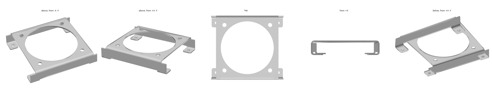

# ultitube-d5-drive-mount-adapter

An adapter that mounts the [Aqua Computer ULTITUBE D5](https://shop.aquacomputer.de/Water-Cooling/Pumps-Accessories/Pumps-with-reservoirs/ULTITUBE-D5-100-reservoir-with-D5-PWM-pump::3848.html) to a 2.5-inch drive mounting position (SFF-8201).

```shellsession
$ uv run ultitube-d5-drive-mount-adapter out
```



The ULTITUBE D5 side is fastened with the rubber-sleeved screws and nuts included with the ULTITUBE D5, and the drive side with M3×0.5 thin hex nuts (1.8 mm high, 5.5 mm across flats) conforming to ISO 4035 or a compatible standard (in Japan: JIS 六角ナット3種). PC cases generally ship with 2.5-inch drive screws that are 3-4 mm long. Because the plate is 1.5 mm thick, 4 mm screws are preferable where available to secure enough thread engagement.

## Development

```shellsession
$ uv run mypy
$ uv run ruff check
$ uv run ruff format --check
```
